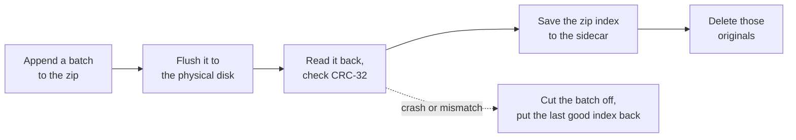

<h1 align="center">nestzip</h1>

<p align="center">
  <strong>Zip a folder that doesn't fit twice on your disk.</strong><br>
  Each file is deleted as soon as it is safely in the archive,<br>
  so you only need free space for one batch, not for a second copy of everything.
</p>

<p align="center">
  <a href="https://github.com/YakuR11/nestzip/actions/workflows/tests.yml"></a>
  
  
  
  <a href="LICENSE"></a>
</p>

<p align="center">
  
</p>

## Why

Your disk is almost full and you want to zip a big folder to free some space. 7-Zip, WinRAR and `zip` all need the originals **and** the finished archive on disk at the same time, so a 200 GB folder needs about 200 GB of free space before you can save anything. If you don't have it, you're stuck.

nestzip packs the folder batch by batch and deletes each batch of originals once it is in the archive, flushed to disk and checked. The result is a normal `.zip` that Windows, macOS, 7-Zip, WinRAR and `unzip` open as usual.

It's the reverse of [HatchZip](https://github.com/xevrion/hatchzip), which does the same trick for extracting.

## Quick start

One file, Python 3.10 or newer, no dependencies.

```
pipx install git+https://github.com/YakuR11/nestzip
nestzip check MyFolder     # will it fit? changes nothing
nestzip pack MyFolder      # -> MyFolder.zip, MyFolder is gone at the end
```

No pipx? Clone the repo and run `python nestzip.py` instead of `nestzip`.

## Usage

```
nestzip check MyFolder                  # can it fit? changes nothing
nestzip pack MyFolder                   # asks before starting, then packs
nestzip pack MyFolder -o D:\Archives\my.zip
nestzip pack Videos --store             # no compression, much faster for videos and photos
```

| Option | Effect |
| --- | --- |
| `-o, --output` | Archive path. Default: `<folder>.zip` next to the folder. |
| `--batch <size>` | How much is packed before each delete step. Default `256MB`. Bigger is faster, smaller needs less space. |
| `--keep-free <size>` | Free space nestzip never uses. Default `1GB`. |
| `--store` | No compression. |
| `-y, --yes` | No confirmation prompt (`pack` only). |

Sizes are written like `512MB`, `1.5G` or `0`.

Exit codes: `0` success, `1` error, `2` bad command line, `3` not enough space (nothing changed), `130` paused with Ctrl+C.

## Stop and resume

Ctrl+C, crash, power cut, disk filled by something else: run the **same command** again and it picks up where it stopped.

While a run is unfinished there is a small `MyFolder.zip.nestzip` file next to the archive. **Don't delete it**: it holds the last known-good index of the archive.

## Is it safe?

nestzip deletes your files, so it's built around one rule: **a file is only deleted once its copy in the archive is on the physical disk and checked.**



If anything fails before the last step, the half-written batch is cut off and the last good index is put back: no original has been deleted and the archive is valid. On resume, files that are already in the archive but weren't deleted yet are compared with the archive again (CRC-32) before they're removed. If a file was edited in between, nestzip stops and deletes nothing.

It refuses, before touching anything:

- a run that doesn't fit in the free space,
- a whole drive (`C:\`, `/`), or an archive inside the folder being packed,
- a second nestzip working on the same archive at the same time,
- a damaged sidecar, instead of trusting it.

It leaves these alone, and lists them in its output:

- **links**: symlinks, Windows junctions and other reparse points are never followed, so nothing outside the folder is ever packed or deleted, and every path is checked again right before it is read and deleted,
- devices, sockets and other special files,
- names other systems can't read back safely: invalid UTF-8, or a `\` in a Linux or macOS file name.

Empty folders are kept in the archive. Files dated before 1980, which zip can't store, get the 1980 date in the archive.

What it can't protect against: a disk that lies about flushing, or a file that another program is writing while nestzip packs it (it notices a size change and stops, but close your apps first).

If the archive is on a **different disk** than the folder, deleting the originals frees nothing on the archive's disk: `check` tells you, and it then needs the full size like any other tool.

## How it works

A zip file is a list of entries followed by an index (the central directory) at the very end. Appending to a zip means writing new entries over the old index, then a new index after them. After each batch, nestzip saves a copy of the last good index and its position in the sidecar file. To recover, it truncates the archive at that position and writes the saved index back: everything from the interrupted batch disappears, everything before it is intact.

## Measured

1200 files, 285.6 MB (two thirds random data, one third text), `--batch 64MB`: packed in 10 to 15 s into a 191.7 MB archive, every file byte-identical, on Windows 11 with an AMD Ryzen 9 5900HX and an NVMe SSD.

Crash safety: the process was killed (`TerminateProcess`, `SIGKILL`) at random moments until each run finished, 400 files and 5 empty folders per run. That was 463 kills over 18 runs on Windows and 4562 kills over 16 runs on Linux (Python 3.10 and 3.15), and every entry came out byte-identical each time.

## How this project was made

This is my first project on GitHub, and I built it with AI.

- **The idea** comes from [HatchZip](https://github.com/xevrion/hatchzip) by xevrion, which extracts huge archives in place. I wanted the opposite direction: compress in place.
- **The code** was written with [Claude Code](https://claude.com/claude-code), Anthropic's coding agent, using the [ponytail](https://github.com/dietrichgebert/ponytail) skill: a "lazy senior developer" mode that writes the smallest change that fully solves the problem and nothing more. That's why nestzip is one readable file with no dependencies.
- **The review**: before publishing, I had the project reviewed three times, as a software engineer, a security engineer and a pentester. It found a real bug: a Windows junction inside the folder made the first version delete files *outside* it. That's fixed and tested, along with every other issue the review found ([the commit](https://github.com/YakuR11/nestzip/commit/03e0a84) lists them all).
- **The checks**: each fix comes with a test, the tests run on Windows, macOS and Linux on every push, and the numbers above come from real runs, not estimates.

I'm learning by doing, so issues and suggestions are very welcome.

<details>
<summary><strong>En français</strong></summary>

nestzip compresse un dossier « sur place » : chaque fichier est supprimé dès qu'il est en sécurité dans l'archive (écrit sur le disque, relu et vérifié). Il suffit donc d'avoir la place d'un lot (256 Mo par défaut), pas d'une deuxième copie de tout le dossier. On peut l'interrompre à tout moment (Ctrl+C, plantage, coupure de courant) et le relancer avec la même commande : il reprend là où il s'était arrêté.

C'est mon premier projet GitHub. L'idée vient de [HatchZip](https://github.com/xevrion/hatchzip), qui fait l'inverse (extraire sur place). Je l'ai codé avec l'aide de l'IA (Claude Code, avec le skill ponytail : le code le plus simple qui fait tout le travail), puis je l'ai fait relire comme le feraient un ingénieur logiciel, un ingénieur sécurité et un pentesteur. Tout est testé sur Windows, macOS et Linux.

</details>

## Tests

```
python -m unittest -v
```

Covers a full pack, a power cut in the middle of a batch, kills while deleting and right after starting, a file edited between two runs, a disk that's too full, a damaged sidecar, two runs at once, the source folder moved away mid-run, links and junctions pointing outside the folder, links planted next to the archive, and files dated 1970. CI runs them on Windows, macOS and Linux.

## Contributing

Bug reports and pull requests are welcome: see [CONTRIBUTING.md](CONTRIBUTING.md). If you find a way to make nestzip delete something it shouldn't, please report it privately: see [SECURITY.md](SECURITY.md).

If nestzip got you out of a full-disk situation, a star helps other people find it.

## License

[MIT](LICENSE)
